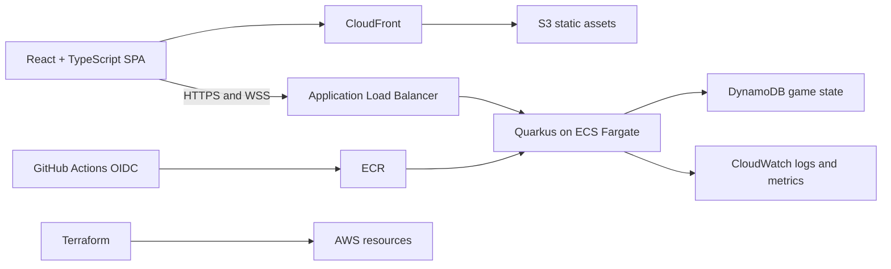

# OFC Poker

A private, invite-only table for 2-3 players to play **Pineapple Open Face
Chinese poker** in the browser, with server-authoritative rules, reconnect
support, and a production-style (but cost-conscious) AWS deployment.

See [`docs/rules.md`](docs/rules.md) for the exact rules/scoring variant
implemented, and [`docs/adr/`](docs/adr) for the architecture decisions
behind the stack.

## Architecture



- **`backend/`** - Quarkus (Java 25 / Amazon Corretto) REST + WebSocket API.
  The rules engine (`poker.ofc.domain`) has no dependency on transport or
  storage and is exhaustively unit tested on its own.
- **`frontend/`** - React + TypeScript + Vite SPA. API types are generated
  from the backend's OpenAPI contract (`npm run generate:api`), never
  hand-duplicated.
- **`infra/`** - Terraform for staging/production AWS environments.
- **`docs/`** - Rules interpretation, architecture decision records, and
  operational runbooks.
- **`legacy-python-prototype/`** - The original Flask/React spike, kept for
  reference only; not part of the current app.

## Local development

Prerequisites: JDK 25 (Amazon Corretto recommended), Node.js 20+, Docker.

```bash
# 1. Start local dependencies (DynamoDB Local + a small admin UI on :8001)
docker compose up -d

# 2. Backend (http://localhost:8080)
cd backend
./mvnw quarkus:dev

# 3. Frontend (http://localhost:5173), in another terminal
cd frontend
cp .env.example .env.local
npm install
npm run dev
```

Whenever the backend's API contract changes, regenerate the frontend's
types (requires the backend running locally):

```bash
cd frontend
npm run generate:api
```

## Testing

```bash
# Backend unit tests (fast, no external dependencies)
cd backend && ./mvnw test

# Backend integration tests (requires docker compose up -d dynamodb-local)
cd backend && ./mvnw verify -DskipITs=false

# Frontend: types, lint, unit/component tests, production build
cd frontend
npm run lint
npx tsc -b
npm run test
npm run build

# Frontend end-to-end tests (requires DynamoDB Local + the backend running
# on :8080 - see frontend/e2e/README.md)
npm run e2e
```

## Containers and CI/CD

- `backend/Dockerfile` is a multi-stage build (Corretto 25 JDK to build, a
  headless Corretto 25 JRE to run) producing a non-root, health-checked
  image. The frontend ships as static assets to S3/CloudFront rather than as
  a container - see [`docs/adr/0001-rewrite-stack.md`](docs/adr/0001-rewrite-stack.md).
- `.github/workflows/backend-ci.yml` and `.github/workflows/frontend-ci.yml`
  run on every pull request: tests, lint/typecheck, the production build,
  a container image build + Trivy scan (backend), and a full Playwright
  run against DynamoDB Local + the packaged backend (frontend).
- `.github/workflows/terraform-ci.yml` runs `fmt`/`validate`/`plan` for both
  Terraform environments on pull requests that touch `infra/`.
- `.github/workflows/deploy-staging.yml` and `deploy-production.yml`
  Terraform-apply and redeploy via GitHub OIDC (no long-lived AWS keys);
  production requires an approved GitHub Environment review.

## AWS infrastructure

`infra/` provisions everything in the architecture diagram above:

- **`infra/bootstrap/`** - one-time, manually-applied setup: the shared
  Terraform state bucket, the ECR repository, and the GitHub Actions OIDC
  provider/IAM roles every workflow assumes. See
  [`docs/runbooks/aws-bootstrap.md`](docs/runbooks/aws-bootstrap.md) to go
  from a bare AWS account to a deployable one.
- **`infra/modules/`** - reusable building blocks (network, DynamoDB, JWT
  keypair/secrets, ACM certificate, ECS/ALB backend service, CloudFront/S3
  frontend, AWS Budgets).
- **`infra/envs/staging/`** and **`infra/envs/production/`** - the two
  environments, each a thin composition of the modules above with its own
  Terraform state, sized differently (see `main.tf` in each) but otherwise
  identical - see [ADR 0004](docs/adr/0004-single-task-launch-runtime.md) and
  [ADR 0005](docs/adr/0005-aws-deployment-topology.md) for the reasoning
  behind the single-task, no-NAT, shared-certificate design.

Day-to-day operations are documented in `docs/runbooks/`:
[deploying and rolling back](docs/runbooks/deploy-and-rollback.md),
[rotating secrets](docs/runbooks/secrets-rotation.md),
[the DynamoDB restore drill](docs/runbooks/restore-drill.md), and the
[production/staging smoke test checklist](docs/runbooks/production-smoke-test.md).
`scripts/loadtest/` has a k6 load-test script and a Node.js race-condition
checker for validating a deployed environment before promoting it.
